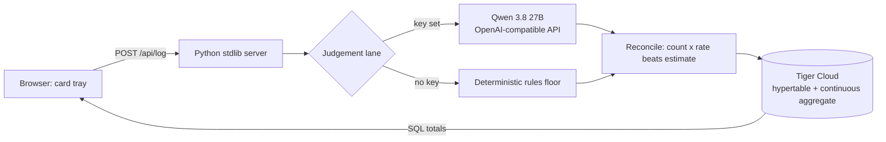

# Sloth Ledger: the model has an opinion, the ledger has the numbers

**TL;DR** — Describe a chore in plain English. An open-weight model decides whether to automate it, hand it to a human, or ignore it forever. When an automation actually runs, the reclaimed minutes go into a Tiger Cloud hypertable, and every figure on screen prints the arithmetic that produced it. Runs locally with `python app.py`; no build step, no framework, no key required.

Repo: <https://github.com/ramantiw45/SlothLedger>

<!-- image: desktop -->


## The problem with "this saved me hours"

Every automation post ends the same way. The tool saves you time, the author says so, and the number is whatever the author felt like typing.

I have written two of those posts this month. So this week I wanted to build the opposite: a ledger that refuses to print a saving it cannot show. Not a productivity dashboard with a big friendly number, but the receipt behind the number, including the part where the automation did not pay off.

The theme is Slow and Steady. The slow part is the accounting. The steady part is that the accounting keeps working after the demo is over.

## One rule, enforced in code

The model never produces a figure that ends up in the ledger.

- If the chore carries a countable quantity, the minutes come from **count × a per-item rate** kept in a plain table in `sloth/model.py`: a receipt is 20 seconds, a statement line 30, a file rename 8. You can read the table and argue with it.
- If you measured the chore yourself, your number wins.
- Only when there is nothing countable does the model's estimate stand, clamped to 1–480 minutes.
- Weekly and all-time totals come from SQL. Never from text a model generated.

In a live call during the build, the model proposed 20 minutes for *renamed 40 receipts from the shoebox*. The ledger booked 13, because 40 × 20 seconds is arithmetic and arithmetic belongs to the database. That disagreement is the feature. A card prints `40 × 8s = 5 min` under its description, so you can check it with a calculator and a bad attitude.

The trust boundary is not "we used a good model". It is that the opinion and the number travel on separate wires.

## What it looks like

The interface is a card tray, not a dashboard: manila index cards on a dark desk, verdicts as rubber stamps, a punch hole in every card whose minutes came back, and a total that gets restamped when the ledger changes.

<!-- image: mobile -->


I went this way because every productivity tool looks like the same grid of rounded KPI tiles, and a ledger should look like something you could drop on a desk. The ruled lines are not decoration: typed text sits on them at a fixed 28px rhythm.

## Slow and steady, measured

The demo ledger, after eight chore entries and four automation runs:

| | |
|---|---|
| Reclaimed this week | **15m** |
| All time | **43m** |
| Still on you | **16m** |
| Chores judged | **8** |
| Automations run | **4** |

That *still on you* line is the one I care about. It is the manual time in chores the tool declined to automate, and it is allowed to grow. A ledger where every number only goes up is a sales pitch, not a record.

Fifteen minutes in a week is not a headline. It is what an honest first week looks like when you count setup time against savings and refuse to round up.

## Why open weights are the core, not a badge

The judgement lane is **Qwen 3.8 27B**, an open-weight model served over an OpenAI-compatible API by Groq. Three environment variables point the app at any compatible host, including a local server on `http://127.0.0.1:11434/v1` if you prefer to keep it on your own machine. The demo used the hosted lane; the model that judged those eight chores was `qwen/qwen3.8-27b`.

Under it sits a deterministic rules floor. With no key, no network, and no model, the app still answers: same output shape, same ledger, a little dumber about intent. That means the product never depends on a vendor staying online, staying affordable, or staying in business.

Why not a closed model? Two reasons, and the second is the one judges should care about.

1. **Swap cost.** The model is one file and one HTTP call. Replacing it with next year's open-weight model is a config change, not a migration. The per-item rates, the schema, and the arithmetic do not move.
2. **Auditability.** The whole argument of this project is that an opinion and a number should not come from the same black box. A closed API that both judged the chore and totalled the savings would reproduce exactly the problem the ledger exists to solve.

Open innovation here is not a licensing preference. It is what lets a stranger re-run my arithmetic on their own machine and get the same ledger.

## How it works



The stack is deliberately small: `http.server`, vanilla HTML/CSS/JS, SQLite as the default store, and `pg8000` (pure Python) for the Postgres lane. Python 3.14 has no wheels for most Postgres drivers, and a compiler on the judge's laptop is a bad install story.

### What Tiger Data is doing that SQLite is not

The reclaimed minutes are a time series, so they live in a hypertable:

```sql
CREATE TABLE ledger.reclaimed (
    reclaimed_at timestamptz NOT NULL,
    chore_id     bigint REFERENCES ledger.chore (id) ON DELETE CASCADE,
    automation   text NOT NULL,
    minutes      numeric NOT NULL CHECK (minutes >= 0),
    source       text NOT NULL DEFAULT 'run'
);
SELECT create_hypertable('ledger.reclaimed', 'reclaimed_at');
```

The top-automations panel does not scan that table. It reads `ledger.reclaimed_daily`, a continuous aggregate bucketed by day with a refresh policy, so the query stays small as history grows. A compression policy moves chunks older than 30 days to columnar storage. In this deployment the app connects as a least-privilege role (`sloth_app`) with grants on the ledger schema only, not as the database owner.

None of that is visible in a screenshot, which is the point: it is the difference between a demo that survives a year of entries and one that gets slower every week.

## Three things that broke, written down

1. **Groq returned 403 with no useful body.** Python's default `User-Agent` was being rejected by the WAF in front of the API. Identifying the client (`sloth-ledger/0.1`) fixed it. This is the kind of bug that looks like a bad key for an hour.
2. **`llama-3.3-70b-versatile` was gone.** The model name from every tutorial returned 404. Listing `/models` for the key showed the current catalogue and I moved to `qwen/qwen3.8-27b`. Pinning a model name in a tutorial is a gift with an expiry date.
3. **Tiger returns `numeric` as `Decimal` and timestamps as `datetime`.** `json.dumps` refused both. The fix belongs at the store boundary, not in every route: one normalising step in `_rows`.

## Related work

Week 3 has a healthy sloth population. [Sloth Errands](https://dev.to/anishisbusy/sloth-errands-an-agent-that-does-my-web-chores-while-i-sleep-and-asks-before-it-pays-2n20) runs web chores overnight and asks before it pays; [SlothDesk](https://dev.to/rudraksh_karmakar_28/slothdesk-ai-do-less-busywork-get-more-of-your-day-back-36mp) goes after digital busywork; [InvoiceSnap](https://dev.to/leafyte/invoicesnap-ai-turn-receipt-photos-into-organized-expenses-with-local-ai-1dli) turns receipt photos into expenses with local AI.

All three automate the chore. Sloth Ledger asks the next question: did it actually pay? That is why the tray keeps the chores it refused, and why the total is allowed to be small.

## Run it yourself

```bash
git clone https://github.com/ramantiw45/SlothLedger
cd SlothLedger
python app.py                       # http://127.0.0.1:8787
```

No install step. Without a `.env` you get the rules floor and a SQLite file. To use the same lanes as the demo, copy `.env.example` to `.env` and set `MODEL_BASE_URL`, `MODEL_API_KEY`, `MODEL_NAME`, and optionally `DATABASE_URL` for Tiger Cloud.

The checks I ran before writing this:

```text
python tests/test_ledger.py     -> 11 tests, OK
python tools/smoke_http.py      -> 15 checks passed (live server, real database)
```

The smoke test logs a chore, books an automation, refuses a second booking of the same chore, and rejects an empty description. The SQLite and Postgres lanes share one interface, so the same suite covers both.

## Credits and disclosure

Built for the Hacktoberfest Open-Source AI Challenge, Week 3. MIT licensed. The demo corpus is a labelled synthetic freelancer week, not a real person's measurements; the eight chores live in `tools/seed_demo.py` and you can replace them with your own.

AI assistance: I used an AI coding agent for implementation and editing, and an open-weight model at runtime for judgement. Every number in the screenshots comes from the database, and the arithmetic that produced each one is printed on its card.
